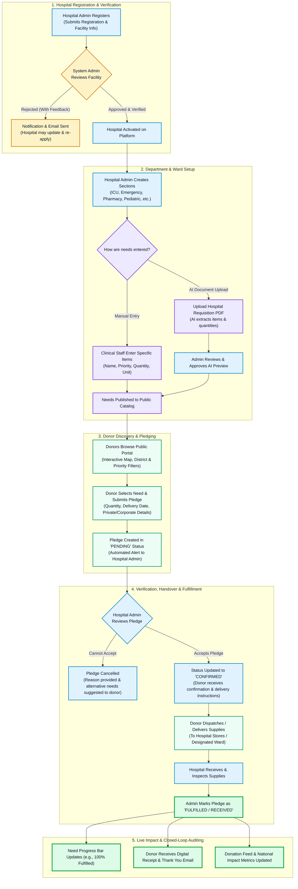

# Hospital Donation & Needs Management System
## Comprehensive Project Overview & Operational User Guide

**Target Audience:** Hospital Directors, Medical Superintendents, Section Heads, Administrative Personnel, and Donors  
**Platform Reference:** Rebuild Management System (NeedTracker / Parithyaga)  
**Document Classification:** Non-Technical Stakeholder Overview & Standard Operating Procedure (SOP)

---

## Table of Contents
1. [Executive Summary & Real-World Importance](#1-executive-summary--real-world-importance)
2. [Key Users & Organizational Roles](#2-key-users--organizational-roles)
3. [End-to-End Visual Workflow (Mermaid Diagram)](#3-end-to-end-visual-workflow)
4. [Step-by-Step User Journey Guides](#4-step-by-step-user-journey-guides)
   - [Journey 1: Hospital Leadership & Administrators](#journey-1-hospital-leadership--administrators)
   - [Journey 2: Section Heads & Clinical Ward Staff](#journey-2-section-heads--clinical-ward-staff)
   - [Journey 3: Donors (Individuals & Organizations)](#journey-3-donors-individuals--organizations)
   - [Journey 4: Platform System Administrators](#journey-4-platform-system-administrators)
5. [Key Platform Features & Real-World Benefits](#5-key-platform-features--real-world-benefits)
6. [Operational FAQs & Best Practices](#6-operational-faqs--best-practices)

---

## 1. Executive Summary & Real-World Importance

### 1.1 The Real-World Healthcare Challenge
Hospitals and healthcare facilities face unpredictable supply pressures. During emergency situations, seasonal epidemics, or routine economic constraints, individual hospital departments—such as the Intensive Care Unit (ICU), Emergency Treatment Unit (ETU), Operating Theatres, and Maternity Wards—often experience critical shortages of specialized medical supplies, pharmaceuticals, and consumables.

Traditional donation drives often encounter severe logistical and communication bottlenecks:
* **The "Donation Mismatch" Problem:** A hospital might receive thousands of ordinary bandages while running completely out of oxygen cylinders, infant incubators, or life-saving intravenous antibiotics.
* **Lack of Ward-Level Visibility:** Hospital directors and administrative teams struggle to compile real-time, consolidated requirement lists from different clinical sections quickly.
* **Donor Uncertainty & Trust Deficits:** Well-intentioned donors (both private citizens and corporate philanthropic foundations) often hesitate because they cannot verify what a hospital truly needs right now, nor can they confirm whether their physical contribution reached the doctors and patients who needed it.
* **Administrative Burden:** Processing paper supply requests and coordinating donor logistics manually diverts medical staff from direct patient care.

### 1.2 The Solution
The **Hospital Donation & Needs Management System** is an intuitive, transparent digital bridge linking hospital clinical wards directly with compassionate donors across the country and around the world. 

Instead of vague appeals or generic monetary pools, the platform provides **ward-level, item-specific visibility**. Clinical staff specify exact items, quantities, measurement units, and urgency levels. Donors can view verified requirements, pledge specific quantities, track delivery timelines, and receive formal delivery confirmations once items are inspected and accepted on the hospital premises.

### 1.3 Core Business Values & Operational Benefits
* **Precision Humanitarian Relief:** Directs donor generosity straight to where lives are at risk, eliminating redundant or unusable donations.
* **Radical Transparency & Accountability:** Every supply item is tracked through an auditable lifecycle: *Identified &rarr; Published &rarr; Pledged &rarr; Confirmed &rarr; Physically Delivered*.
* **Time Savings via Artificial Intelligence:** Clinical directors can upload existing PDF supply lists and let built-in AI extract and categorize items automatically, reducing hours of manual typing to a two-minute verification.
* **Geographic Equity:** An interactive national map highlights underserved regional and rural hospitals alongside major urban teaching centers, ensuring balanced relief across all provinces.

---

## 2. Key Users & Organizational Roles

The platform provides dedicated, security-controlled environments for four distinct groups of users:

```
+-----------------------------------------------------------------------------------+
|                                 PLATFORM USERS                                    |
+--------------------------+----------------------------+---------------------------+
|    HOSPITAL PERSONNEL    |        DONORS              |   SYSTEM GOVERNANCE       |
|  - Hospital Admin        |  - Private Individuals     |  - System Administrator   |
|  - Section Heads / Leads |  - Corporate & NGOs        |                           |
+--------------------------+----------------------------+---------------------------+
```

### 2.1 Hospital Administrators (`ORG_ADMIN`)
* **Who they are:** Medical Superintendents, Hospital Directors, Chief Operating Officers, or senior administrative and procurement officers designated to represent the healthcare institution.
* **Core Responsibilities:**
  * Register the hospital facility on the platform with official accreditation details.
  * Define and manage hospital wards and departments (Sections).
  * Invite and manage colleague administrators to help run the hospital profile.
  * Review, verify, and confirm donor pledges.
  * Acknowledge physical deliveries and mark items as received upon arrival at the hospital stores.
  * Monitor ward fulfillment rates, critical shortage levels, and overall delivery statistics.

### 2.2 Section Heads & Clinical Staff
* **Who they are:** Doctors, Consultant Specialists, Head Nurses, Pharmacists, and Ward Supervisors leading specialized units (e.g., Pediatric Ward, Surgical Theatre, Hemodialysis Unit, Central Pharmacy).
* **Core Responsibilities:**
  * Accurately list supply items needed on the clinical floor.
  * Assign urgency tiers (**Critical**, **Essential**, or **Nice to Have**).
  * Specify precise quantities and standard medical packaging units (Units, Boxes, Kilograms, Liters).
  * Upload existing requisition documents (PDFs) for instant AI extraction.
  * Update requirements as patient influx and inventory levels shift.

### 2.3 Donors (`DONOR`)
* **Who they are:** 
  * **Private Donors:** Individual citizens, alumni associations, expatriates, and community groups.
  * **Institutional / Corporate Donors:** Corporate Social Responsibility (CSR) departments, non-governmental aid organizations, and trade associations.
* **Core Responsibilities:**
  * Browse verified hospital needs filtered by location, hospital name, and urgency.
  * Select specific medical needs and submit a pledge for full or partial quantities.
  * Provide estimated delivery dates, supportive messages, or official organizational letters.
  * Track pledged items in real time through their personal Donor Dashboard.
  * Coordinate safe shipping or physical handover directly to the hospital.

### 2.4 System Administrators (`ADMIN`)
* **Who they are:** Central platform oversight personnel responsible for nationwide governance and platform security.
* **Core Responsibilities:**
  * Review and verify incoming hospital registration requests before they go live.
  * Ensure only officially accredited hospitals publish needs to the public.
  * Broadcast emergency announcements across the entire platform.
  * Monitor nationwide healthcare metrics, regional coverage, and donor fulfillment rates.

---

## 3. End-to-End Visual Workflow

The entire lifecycle—from a hospital joining the platform to physical supply delivery—follows a clear, verified sequence:



---

## 4. Step-by-Step User Journey Guides

### Journey 1: Hospital Leadership & Administrators

#### Step 1: Hospital Registration & Onboarding
1. Visit the platform homepage and click **"Register as Organization"**.
2. Select **Hospital** or **Clinic** as your organization type.
3. Provide your hospital's official information:
   * **Hospital Name** (e.g., *Teaching Hospital Karapitiya* or *District General Hospital Gampaha*).
   * **Official Registration / Health Ministry Code**.
   * **District & Address** (The platform automatically places your facility on the interactive map).
   * **Administrative Contact:** Phone number, official email, and website.
4. Submit your application. Your request is queued for central verification.
5. Once verified by the platform system administrator, you will receive an official **Approval Confirmation Email** granting full access to your Hospital Management Dashboard.

#### Step 2: Setting Up Hospital Sections (Wards & Units)
1. Log in and open your **Hospital Dashboard**.
2. Navigate to the **Sections** tab.
3. Click **"Add Section"** to mirror your hospital's real-world internal layout. Examples:
   * *Emergency Treatment Unit (ETU)*
   * *Intensive Care Unit (ICU)*
   * *Maternity & Neonatal Ward*
   * *Pediatric Ward*
   * *Central Pharmacy & Stores*
4. Assign a **Head of Section** (e.g., Dr. Priyantha Senanayake, Head of Surgery) to establish clear clinical ownership.

#### Step 3: Inviting Additional Co-Administrators
1. In your Hospital Dashboard, go to **Manage Admins**.
2. Click **"Invite Admin"**.
3. Enter your colleague's name, official hospital email, and temporary password.
4. An automated welcome email is dispatched to your colleague with immediate access, enabling team-based coordination across shifts.

#### Step 4: Managing Inbound Donor Pledges
1. When a donor pledges supplies, an in-app notification and email alert notify you immediately.
2. In the **Donations** section of your dashboard, view all incoming pledges marked as **Pending Review**:
   * Inspect the donor's identity (Private Individual vs. Corporate / Aid Organization).
   * Review the pledged quantity, expected delivery date, and attached notes or letters.
3. Take action:
   * **Confirm Pledge:** If your hospital can receive the goods, click **"Confirm"**. You can adjust the quantity if a donor offered more than your storage capacity allows (any excess is automatically logged as a surplus record). The donor is instantly notified that their supplies are expected.
   * **Cancel Pledge:** If the requirement was already resolved locally or the items do not meet clinical standards, click **"Cancel"** and provide a courteous explanation. The donor will receive your reason along with suggestions for other urgent hospital needs.

#### Step 5: Acknowledging Physical Delivery (Marking Received)
1. When the delivery arrives at your hospital receiving bay or central stores, inspect the shipment.
2. Open the confirmed donation in your dashboard and click **"Mark as Received"**.
3. This single action:
   * Updates the donation status to **Fulfilled**.
   * Automatically updates your ward's need progress bar.
   * Dispatches an official **Receipt & Delivery Confirmation Email** thanking the donor.

---

### Journey 2: Section Heads & Clinical Ward Staff

#### Step 1: Identifying Clinical Shortages
As patient loads fluctuate, identify the specific supplies needed to maintain safety and standard of care. Distinguish between life-saving emergency equipment, routine operational supplies, and facility enhancements.

#### Step 2: Entering Needs Manually
1. Access your hospital's section management page.
2. Click **"Add Need Item"** and fill in the clean form:
   * **Item Name:** Use clear, recognizable clinical terminology (e.g., *Pediatric Saline 500ml*, *N95 Surgical Respirators*, *Infant Phototherapy Lamps*).
   * **Priority Level:**
     * **CRITICAL (Red Badge):** Life-saving emergency supplies (e.g., defibrillators, oxygen cylinders, emergency cardiac medication).
     * **ESSENTIAL (Amber Badge):** Vital daily consumables (e.g., surgical gloves, IV infusion sets, sterile gauze, basic antibiotics).
     * **NICE TO HAVE (Blue/Green Badge):** Patient comfort and non-urgent support items (e.g., bedside tables, digital thermometers, waiting area fans).
   * **Quantity Required:** The exact count needed.
   * **Measurement Unit:** Select *Units*, *Boxes*, *Kilograms*, or *Liters*.
   * **Clinical Specifications:** Add helpful notes (e.g., *"Latex-free preferred"* or *"Must be compliant with ISO medical standards"*).
3. Save the item. It is immediately published to the live public portal for donors to see.

#### Step 3: Fast-Track Ingestion via AI Document Upload
When handling an existing official requisition sheet or disaster relief inventory:
1. Navigate to **Document Processing** in the menu.
2. Upload your hospital's requisition document in **PDF format**.
3. Click **"Process with AI"**.
4. The built-in AI assistant scans the document, reads the text, and extracts:
   * Item names
   * Quantities needed
   * Recommended measurement units
   * Suggested ward sections (e.g., Pharmacy vs. Emergency)
   * Proposed priority classifications
5. A structured preview is displayed on your screen. You can review, adjust quantities, rename sections, and click **"Approve & Create Needs"**.
6. Dozens of items are instantly created in their respective hospital sections without requiring manual data entry.

---

### Journey 3: Donors (Individuals & Organizations)

#### Step 1: Discovering Needs & Hospitals
1. Visit the platform homepage.
2. Explore hospital requirements using your preferred method:
   * **The Interactive Map:** Click on any province or district across Sri Lanka to view nearby hospitals and their urgent shortfalls.
   * **The Needs Catalog:** Filter requirements by **Priority** (*Critical First*), **Hospital Name**, **District**, or **Fulfillment Status** (*Unfulfilled Only*).
   * **Search Bar:** Type any medical item (e.g., *"oxygen"*, *"gloves"*, *"saline"*) to find all healthcare facilities requesting it.

#### Step 2: Making a Supply Pledge
1. Once you find an item you wish to contribute, click **"Donate / Support Need"**.
2. Choose your donor category:
   * **Private Donor:** Enter your name, phone number, email address, and home district.
   * **Organization / Corporate Donor:** Enter your company or foundation name, CSR initiative title, liaison officer's designation, and official business email.
3. Specify your contribution:
   * **Quantity:** Enter the number of units you will supply (you can fulfill a portion or the entire request).
   * **Estimated Delivery Date:** Select when the hospital can expect the goods.
   * **Message / Delivery Method:** Add delivery details (e.g., *"Shipping via courier with tracking"* or *"Personal handover to hospital reception on Friday morning"*).
   * **Donation Letter (Optional for Corporates):** Attach an official sponsorship letter if required for corporate governance.
4. Click **"Confirm Pledge"**.

#### Step 3: Tracking Your Impact on the Donor Dashboard
1. Log in to your personal **Donor Dashboard**.
2. View all your active and past contributions:
   * **Pending:** Your pledge has been delivered to the hospital administration and is awaiting scheduling confirmation.
   * **Confirmed:** The hospital has verified that the items meet clinical standards and is actively awaiting arrival.
   * **Fulfilled / Received:** Hospital staff have physically inspected, accepted, and shelved the supplies in the ward.
3. If your logistics plan changes, you can safely modify your notes or cancel a pending pledge, allowing another donor to step forward.

---

### Journey 4: Platform System Administrators

#### Step 1: Hospital Facility Verification
1. Open the **System Administration Portal** and click **"Approvals"**.
2. Review pending hospital registration requests:
   * Verify the hospital's official name, government registration number, district, and contact details.
3. Take action:
   * **Approve:** Clicking **"Approve"** immediately activates the hospital, attaches the applicant as the primary Hospital Administrator, and sends a formal onboarding email.
   * **Reject:** If details are invalid or fraudulent, enter a transparent explanation and click **"Reject"**. The applicant receives an explanation and may re-apply with corrected information.

#### Step 2: Nationwide Health Monitoring & Alerts
* Monitor real-time platform metrics: total verified hospitals, active clinical needs, nationwide delivery success rate, and district-by-district fulfillment.
* In times of regional natural disasters or critical emergencies, open the **Broadcast Alert** tool to dispatch urgent notifications to all registered donors or hospital administrators simultaneously.

---

## 5. Key Platform Features & Real-World Benefits

### 5.1 AI-Powered Requisition Ingestion (Gemini Medical Document Scanner)
* **What it does:** Uses intelligent document processing to convert standard hospital PDF requisition forms into structured digital inventory requirements in seconds.
* **Why it matters:** Doctors and administrative staff are under intense time pressure. Instead of spending hours re-typing inventory spreadsheets, a single PDF upload automatically populates item descriptions, counts, and priorities.
* **Human-in-the-Loop Safeguard:** AI suggestions are never published automatically. Hospital administrators always review, modify, and explicitly approve the extracted items before donors can view them.

### 5.2 Three-Tier Urgency Matrix
To prevent donor confusion and focus attention where it is needed most, every item is categorized under an unambiguous priority framework:

| Priority Level | Visual Badge | Clinical Definition | Typical Examples |
| :--- | :---: | :--- | :--- |
| **CRITICAL** | 🔴 Red | Life-saving items required immediately; absence leads to patient compromise. | Oxygen cylinders, defibrillators, blood transfusion sets, emergency resuscitation medicines. |
| **ESSENTIAL** | 🟡 Amber | Important operational supplies needed for daily inpatient and outpatient care. | Saline bottles, surgical gloves, antibiotics, digital blood pressure monitors, wound dressings. |
| **NICE TO HAVE** | 🟢 Blue / Green | Non-urgent supplies that enhance patient comfort, staff efficiency, or long-term care. | Bedside tables, examination room fans, extra linens, non-urgent vitamins, digital thermometers. |

### 5.3 Automated Geocoding & Interactive National Map
* **Automatic Coordinate Resolution:** When a hospital is registered with its address and district, the platform automatically geolocates the facility on the map.
* **Geographic Balance:** Donors can visually identify remote rural clinics that may not receive the public attention that major teaching hospitals receive, ensuring equitable resource distribution.

### 5.4 Intelligent Surplus & Over-Allocation Prevention
* **Need Fulfillment Progress:** Need cards feature dynamic progress bars displaying exact quantities pledged vs. remaining requirements.
* **Surplus Segregation:** If a donor offers 150 units for a need requiring only 100, the system prompts the administrator to accept the needed 100 and cleanly logs the remaining 50 as surplus. This prevents stock hoarding and guides donors toward other hospitals experiencing deficits.

### 5.5 Dual-Track Donor Workflows (Private vs. Corporate)
* **For Private Citizens:** Quick, simple pledge process requiring only basic contact details and a delivery date.
* **For Corporate & Institutional Donors:** Full fields for company identity, officer designation, program names, and official PDF sponsorship letters suitable for CSR audits and corporate tax documentation.

### 5.6 Automated Multi-Channel Notification Engine
* **Real-Time Web Alerts:** In-app notification center with unread badges, timestamped alerts, and one-click navigation to relevant records.
* **Responsive Email Updates:** Professionally formatted emails sent at every milestone:
  * Hospital Admin Approval or Rejection (with reasons).
  * New Donor Pledge alerts sent to hospital directors.
  * Pledge Confirmation sent to donors with hospital delivery guidelines.
  * Official Delivery Receipt & Thank-You email sent once items arrive safely.
  * Constructive cancellation notices with instant suggestions for other urgent needs.

---

## 6. Operational FAQs & Best Practices

### For Hospital Leadership & Clinical Staff

**Q: Can one hospital have multiple administrators?**  
*A:* Yes. Once the primary hospital account is approved, the Hospital Administrator can use the **"Invite Admin"** feature to onboard department heads, procurement officers, and senior nurses.

**Q: What if our hospital receives supplies through another channel while a need is active on the platform?**  
*A:* You can edit or remove the need item at any time, or adjust the "Quantity Required" down to reflect your new inventory status. Keeping your listings accurate prevents donors from procuring items you no longer require.

**Q: How do we handle perishable pharmaceuticals or items requiring cold-chain storage?**  
*A:* Always mention specific transport and storage requirements in the item's description field (e.g., *"Requires cold-chain storage at 2°C - 8°C during transit"*). When reviewing the donor's pledge, confirm their delivery method before clicking "Confirm".

---

### For Donors & Philanthropic Partners

**Q: Are all hospitals on this platform verified?**  
*A:* Yes. Every healthcare institution undergoes manual review and verification by the System Administrator before it can publish needs to the public.

**Q: Can I donate money directly through the system?**  
*A:* The system is purposefully engineered around **direct supply and equipment fulfillment** rather than generic financial pools. By pledging specific goods, donors retain full oversight over exactly what their funds procure and can confirm delivery directly with the receiving ward.

**Q: What happens if I am unable to deliver my pledged supplies?**  
*A:* Simply log into your **Donor Dashboard**, select the pledge, and click **"Cancel Pledge"**. Providing a quick note allows hospital staff to promptly reopen the requirement so another donor can assist.

---

*Document prepared by the Rebuild Management System Technical Writing & Business Analysis Team.*  
*For platform support, policy inquiries, or institutional onboarding, please visit the platform Help Center.*
